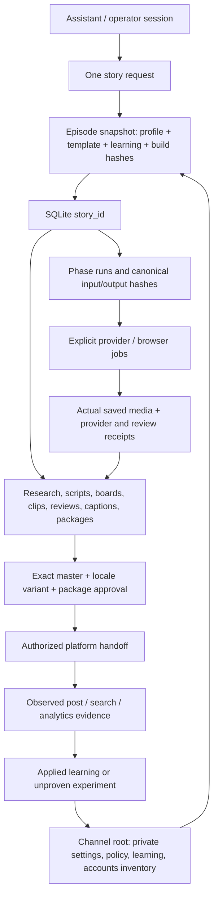

# Production architecture and customization report

As-built reference, reviewed 2026-10-18 against the customized source. The
[main README](../README.md) is the entry point; this report expands its product,
session, data and responsibility contracts. Operational account state and private
channel-specific rules are maintained in the private deployment README.

## System boundary and product responsibility

This is a local Streamlit/Python application with SQLite state, inherited
MoneyPrinter provider integrations and explicit external handoffs. It is not a
hosted autonomous agent team. Production roles are structured instructions and
review responsibilities; the operator or an authorized assistant can fulfill
several roles, but must retain the evidence for each decision.

| Boundary | Products | What crosses it | What must not be inferred |
| --- | --- | --- | --- |
| Planning/development | ChatGPT/Codex and official-source research tools | Owner-approved brief, selected research, code tasks, generated references and saved outcomes | A chat response is not a persisted job, a free API allowance or an automatic daemon |
| Text generation | Configured Claude/OpenAI/other inherited LLM provider | Explicit draft request with redacted creative profile, screenplay/storyboard contract and configured cost route | Provider output is not validated research or accepted production |
| Reference production | Image-generation tool or configured image API | Relevant approved references, staging, wardrobe, composition and output settings | A likeness-approved still does not approve the animated actor |
| Acting generation | Google Flow/Veo browser/manual work | Exact scene reference, native role/voice words, focused camera/action prompt and recorded quote | No continuous generation/upload API or guaranteed lip sync is supplied by this app |
| Independent review | Named human, AI Studio/Gemini or assisted reviewer | Authorized exact clip/final-media bytes, criterion and source hashes | Transcript accuracy or sampled AI observations do not prove phoneme-perfect sync or human viewing |
| Local finishing | FFmpeg/PyAV/MoviePy/audio tooling | Ordered reviewed native takes, exact timing, captions and licensed music/foley | Successful encoding does not approve a movie |
| Distribution | Platform-native interfaces or separately authorized supported adapters | Exact accepted variant, captions, metadata, audience/AI controls and owner authority | A draft package, local approval or account inventory is not a live post or monetization approval |

OpenAI assistant-plan usage and direct API usage have separate access/billing
rules. Claude requests need the configured workspace header when the key is not
workspace-scoped. Flow features/credit costs vary by selected model/account; use
the current UI quote. These are integration prerequisites, not fixed free-credit
or model-availability promises. Official references:
[OpenAI](https://learn.chatgpt.com/docs/pricing),
[Claude](https://platform.claude.com/docs/en/api/overview),
[Flow](https://support.google.com/flow/answer/16352836?hl=en).

## Session and persistence architecture

1. **Channel session:** private files and storage define the brand and account
   context. The initializer creates isolated state outside Git. It copies only
   allowlisted creative rules/applied learning and creates empty asset/account
   inventories. Corporate attribution can be reused, then reviewed for the new
   channel. Browser sign-ins and provider secrets are configured separately.
2. **Episode session:** a unique `story_id` owns a frozen request, actual policy
   and implementation hashes, screenplay/board, original files, review records
   and releases. Two stories remain separate even when worked on concurrently.
3. **Phase execution:** canonical input hashes enable unchanged completed work
   to be reused. Changed upstream inputs invalidate dependent phases and revoke
   affected approvals. Running work prevents a policy refresh. Failed/uncertain
   submissions need explicit recovery, not a blind retry.
4. **Provider/browser session:** external model/account state, quote and outcome
   are recorded independently of the local phase. A browser disconnect, account
   challenge or uncertain charge is a hold, not success. Complete provider
   security checks directly; never repeatedly submit around them.
5. **Release session:** every locale/platform variant has its own exact media,
   voice/caption binding, metadata, review and approval context. Old release
   observations cannot approve a changed file or updated metadata.

`profile_status` compares current profile and implementation-content hashes to
saved values. `refresh_story_profile` is an explicit replan that preserves
history/media and invalidates creative/downstream approvals. Documentation-only
changes are outside the implementation-content file list; Git revisions still
identify the checkout. Applied private learning affects new jobs; experiments do
not silently become requirements or validated quality improvements.

SQLite is configured with WAL and transactions. Its tables are `stories`,
`story_phases`, `phase_runs`, `source_evidence`, `artifacts`, `flow_receipts`,
`approvals` and `analytics_imports`. The database records source paths and hashes;
files, private policy and the archive need their own backup. Do not copy a live
SQLite file casually as a complete backup: stop writers or use SQLite's backup
mechanism and retain the referenced assets separately.

## Production team contracts

| Responsibility | Expected preparation | Acceptance evidence |
| --- | --- | --- |
| Research / source editor | Actual source citations, core beats, variants, cultural context and adaptation decisions | Imported evidence and rights status; an unfetched URL is only a lead |
| Writer / script editor | Beginning, problem, attempts, turn and resolution; role/voice IDs, exact unique lines and timing | Structured screenplay, exact-line board coverage and age-appropriate language |
| Director / casting | Cast bible, motivations, emotional turns, listening reactions, scene objectives and performance mode | Stable characters and actual performed exchanges; not silent figures under narration |
| Choreography / blocking | Gesture, movement, position, eye contact, prop interaction and actor-to-actor response | Physical action and correct speaker visible in the actual take |
| Cinematography / camera | Shot size, axis, lens intention, framing, motivated movement, eyeline and transition | Coherent neighbouring shots without unplanned camera/cast changes |
| Art / costume / lighting | Set-specific references, clothing, props before/after, story clock, weather, sun direction and brightness | Actual continuity across scene boundaries and the finished sequence |
| Animation / voice | Native audible exact words, stable role identity, articulation, body acting and rest handles | Two-role pilot plus entire-utterance normal/half-speed and timed A/V observations |
| Sound / music | Sparse pleasant age-appropriate music, contextual ambience/foley and mix plan | Rights evidence, intelligible native speech and no synthetic fragments or clipped boundaries |
| Caption editor / localization | Exact spoken text, timing, readable safe areas, font coverage and locale | Hashed SRT/VTT, fluent review and actual burned-caption review for the exact media |
| Editor / technician | Ordered moving takes, original A/V clocks, complete story and versioned export | Selection/sequence proof, measured duration, technical decode and preserved sources |
| Quality reviewer | Review actual whole final movie, limitations, every shot opening/ending/join and unresolved issues | Named, source-bound review; negative findings stay held until corrected and re-reviewed |
| Growth / publication | Truthful curiosity title, unique description, relevant tags, accurate thumbnail/category, rights/company credits and native controls | Exact hash-bound package plus actual native post/setting observations |

These are task and evidence contracts. The software checks structure, hashes,
local constraints and required review fields; it cannot independently guarantee
that every creative judgement is correct. Do not invent human attestations.

## Data expected at each stage

| Artifact | Essential inputs | Verification / output |
| --- | --- | --- |
| Story request | `title`, `premise` or `story_input`; optional audience/language, duration, taxonomy, intent, platform targets | `story_id`, normalized request and frozen policy/build; minimum CLI differs from the single-field UI convenience |
| Research evidence | Source/citation, category, supported claim, rights status and available source hash | Classified source/adaptation, visual, voice and music/ambience evidence |
| Screenplay | Role/voice identifiers, exact unique line IDs, scenes/actions, arc and duration | `validate_screenplay`, cinema constraints and stored document hash |
| Storyboard | Closed scene/role/reference IDs, shot duration, exact words, camera/blocking, light/weather/clock, props/costume and transitions/sound | Exact line coverage, continuity/performance requirements and source-bound prompt export |
| Flow quote/bundle | Supported native-speech capabilities, account quote, authorized budget and single output per allowed shot | Pilot-only permissions initially; prompt/recipe hashes and saved-take reuse holds |
| Take receipt | Shot/prompt identity, actual downloaded asset path/SHA, provider/settings/quote and review evidence | Hash-checked local media and per-shot/pilot review; no invented costs |
| Native selection | Ordered actual moving takes, original frame intervals, native audio, words, role voices and locale | Plan validation, review-cut export, sequence review and local finishing candidate |
| Locale variant | Exact media, BCP-47 audio/caption/story locales, voice record, SRT/VTT, fluent and burned-caption reviewers | Normalized locale match, valid measured cues and exact-media hash binding |
| Final review | Story/script/board/policy/master/caption hashes, reviewer identity/kind, actual access/limits, complete checks and boundary observations | Quality remains held on missing/failed criteria or unresolved issues |
| Platform package | Accepted exact variants, rights/audience/AI decisions, prepared titles/descriptions/topics, optional search brief/chapters and private company attribution | Limits, search relevance, copyright/brand footer, engagement handoff and exact metadata/package hash |
| Publication observation | Actual platform/video ID, observed URL/status/settings and evidence context | A publication record distinct from preparation and creative approval |
| Search observation | Exact video ID/current metadata hash, timezone timestamp, query, sign-in/region/browser context, found status and actual result URLs/evidence | Query-specific observation; a miss does not prove non-indexing and a hit does not establish universal rank |
| Analytics / feedback | Actual exported metrics and source, costs with units, specific lesson and supporting observation | Hashed import and measured experiment; unavailable values remain unknown |

Use the current validation code and [operator guide](director-studio.md) for full
field requirements; this table is not a substitute JSON schema or approval.

## Custom implementation map

| Source | Responsibility and customization |
| --- | --- |
| `webui/pages/2_Director_Studio.py` | Intake, frozen/current rule visibility, role documents, Flow handoff, native assembly, review and packaging UI, portable setup |
| `app/services/story_studio.py` | SQLite workflow, profile loading/snapshots, dependency invalidation, evidence/imports, exact approval, analytics and CLI |
| `app/services/studio_cinema.py` | Performed-film screenplay/board/pilot/per-shot/duration contracts and implementation-content identity |
| `app/services/studio_native_movie.py`, `studio_native_media.py` | Reviewed selection validation and native-A/V picture/audio assembly |
| `app/services/studio_native_finish.py` | Source-evidenced local caption/audio repairs reusing a hash-bound native timeline, exact post-normalization 48 kHz conformance and decoded audio sample checks |
| `app/services/studio_finishing.py` | Mandatory actual-final-film and every-boundary acceptance evidence |
| `app/services/studio_captions.py`, `studio_caption_readability.py` | Locale/media/voice/caption registration and readable English timing candidates |
| `app/services/studio_efficiency.py` | Saved-take idempotency, exact asset reuse, lossless stable-prefix prompts and identical-byte technical-decode cache |
| `app/services/cost_router.py`, `cost_router_overrides.py`, `flow_cost_router.py` | Configured task/capability/cost routing, job snapshots, bounded budgets and current Flow quotes; preserve configured model when routing is disabled |
| `app/services/studio_growth.py` | Deterministic platform metadata, verified assets/rights/audience/AI and exact-package approval checks |
| `app/services/studio_discovery.py`, `studio_engagement.py` | Story-supported YouTube search readiness/observations and platform-eligible comments/notification handoff |
| `app/services/media_delivery.py` | Artifact-level dated/versioned copies, content hashes and archive manifests |
| `app/services/studio_channel_setup.py` | Allowlisted policy reuse, fresh accounts/assets, external credentials/storage and portable launch environment |
| `app/services/llm.py`, `app/models/llm_provider.py` | Inherited provider integrations, including configurable Anthropic workspace header |
| `.github/workflows/upstream-monitor.yml`, `scripts/upstream_impact.py` | Test/classify upstream changes and prepare review PRs without automatic approval/merge |

## Reuse, costs and release controls

A matching saved native take blocks duplicate generation even before creative
review. Changed/missing saved media is a recovery hold. Exact actor/set recipes
require matching rights/media/review hashes; a new scene still needs contextual
review. Character speech remains attached to its native video. Narrator caching
requires exact words, voice, locale and settings and is restricted to bridges.

Stable prompt prefixes may permit provider-side caching; actual usage determines
billing. The local decode cache only reuses real technical results for identical
bytes/decoder, never performance approval. A local caption/mix fix preserves
source performances, with source-evidenced cleanup and a new final A/V review.
Generated files keep distinct versions and verified delivery copies.

API money, Flow included credits, assistant usage, narration and local compute
remain separate. The router needs explicit candidate prices and capabilities;
unknown costs are not free. Local ledger/settings do not guarantee a provider
hard cap. Do not spend repeatedly on a provider warning or a request with an
uncertain submission state. No cost strategy can replace acting with still pans,
slow speech, repeated footage, narrator substitution or a short-only delivery.

Company credit/limited copyright notices, relevant brand hashtags and search
terms are private configurable facts rendered into packages. They do not clear
third-party assets. Native audience, AI, rights, category and caption checks remain
required. Comments/notifications are requested only where eligible; YouTube Made
for Kids restrictions and viewer preferences take precedence.

## Portability, maintenance and honest completion

A new laptop needs the reviewed source/dependencies, a private policy backup,
reviewed assets restored deliberately, fresh provider access and correct platform
accounts. A channel initializer does not clone media, live platform sessions,
OAuth connections, billing or old release approval. See
[new-channel setup](new-channel-setup.md) for exact commands and generated files.

The upstream monitor targets fork `main` and produces review PRs. Incorporate
accepted updates into the customized production branch deliberately; "latest"
means the latest reviewed compatible implementation and policy, not an untested
provider/model or vanilla checkout. Run relevant tests, inspect changed data
contracts, preserve originals and replan active jobs when implementation/policy
hashes drift. Documentation is part of the handoff but cannot repair old videos.

A production is complete only when its actual movie and captioned variants pass
the current review/rights/archive gates and the authorized posts are verified.
Examples of incomplete states include an exported prompt with no take, an
unviewed render, a failed final review, unverified archived bytes, a metadata draft
with no saved post, or inaccessible browser/account controls. Do not report these
as generated, approved, fixed, published or monetized respectively.

Validation on 2026-10-19 covered 112 targeted tests, including a real 361.125-second
normalization/PCM/AAC sample-count regression and early source-review validation,
plus Ruff and diff checks. Prior fresh-channel relocation smoke evidence remains
historical. These code checks do not approve a movie or prove any live account
setting; exact-media reviews and publication receipts remain separate. Check
current Git/CI state rather than treating dated validation as a permanent pass.

## Bounded native rollout — cinema contract 3.3.0

The [reviewed-batch workflow](generation-batches.md) adds a mandatory maximum of
four new sources after the two-role pilot, complete source-hashed review before
another handoff, chronological negative-review overrides and downstream approval
invalidation. Director Studio exposes an unpassed form and explicit import.
Provider security/content holds cannot be cleared by exporting another bundle.
This limits rollout exposure inside recorded handoffs; it does not observe
unrecorded clicks or guarantee provider spend. Existing episodes retain their
frozen implementation and require explicit adoption/replan before these gates
can replace their active contract. Batch acceptance does not approve a movie.
